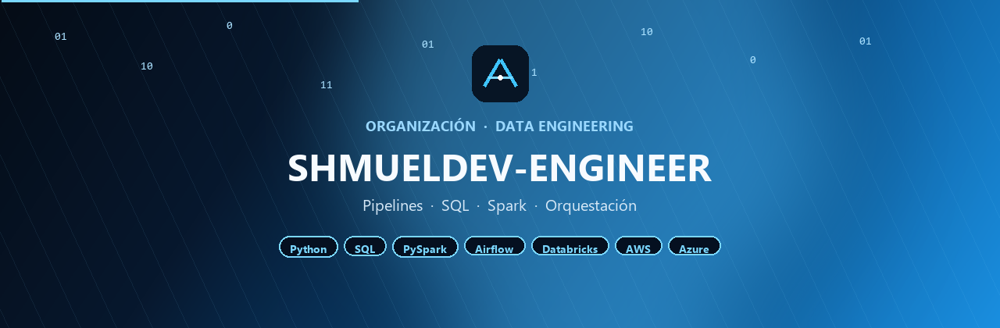



  

 

## Sobre la organización

**SHMUELDEV-ENGINEER** concentra los proyectos de ingeniería de datos de la marca SHMUELDEV: pipelines, transformaciones, orquestación y capas listas para operar en producción.

El objetivo no es acumular notebooks sueltos. Cada repositorio debe mover datos con criterio, ser reproducible y poder ejecutarse sin pasos ocultos.

---

## Qué encontrarás aquí

| Área | Contenido |
| --- | --- |
| **Pipelines** | Flujos ETL/ELT claros, versionados y listos para programar |
| **SQL y transformaciones** | Modelado, limpieza y reglas de negocio en capas |
| **Orquestación** | Airflow y jobs que se pueden monitorear |
| **Plataforma** | Spark, Databricks y nube con despliegue operable |

---

## Stack

  
  
  
  
  
  
  

---

## Proyectos

| Proyecto | Descripción | Estado |
| --- | --- | --- |
| Pipeline base | Primer flujo ETL/ELT de la organización (ingesta + transformación + carga) | Próximo |
| Orquestación Airflow | DAGs reutilizables para programar y monitorear pipelines | Planeado |
| Capa Spark | Jobs PySpark / Databricks con estructura reproducible | Planeado |

> Cuando un repo se publique, esta tabla se actualiza con el enlace real.

---

## Convenciones

- Un repositorio = un pipeline, un dominio de datos o una capa clara.
- README corto: qué mueve, de dónde a dónde y cómo ejecutarlo.
- Entorno reproducible (Docker, notebooks controlados o instrucciones mínimas) desde el primer commit útil.
- Si el flujo no se puede operar y monitorear, no se considera terminado.

---

  
    
  <b>SHMUELDEV</b> · Ingeniería de datos con criterio · Pipelines que se pueden operar

